<div align="center">

# 🏠 homemgmt-ng

**Plan your whole house in 3D – and every compartment of every piece of furniture becomes a storage location.**

House planner, home inventory and shopping list in one self-hosted web app – on the PC, on your phone and on a wall-mounted tablet.

[](https://nodejs.org)
[](#with-docker-recommended)
[](#ai-assistant)
[](LICENSE)
[](https://mupf-dev.github.io/Homemgmt/)

[AI assistant](#the-ai-assistant) · [Features](#features) · [Wall terminal](#wall-terminal) · [Live weather](#live-weather) · [A real house](#a-real-house) · [Installation](#installation) · [Guide](#guide) · [Operation](#operation) · [Development](#development)

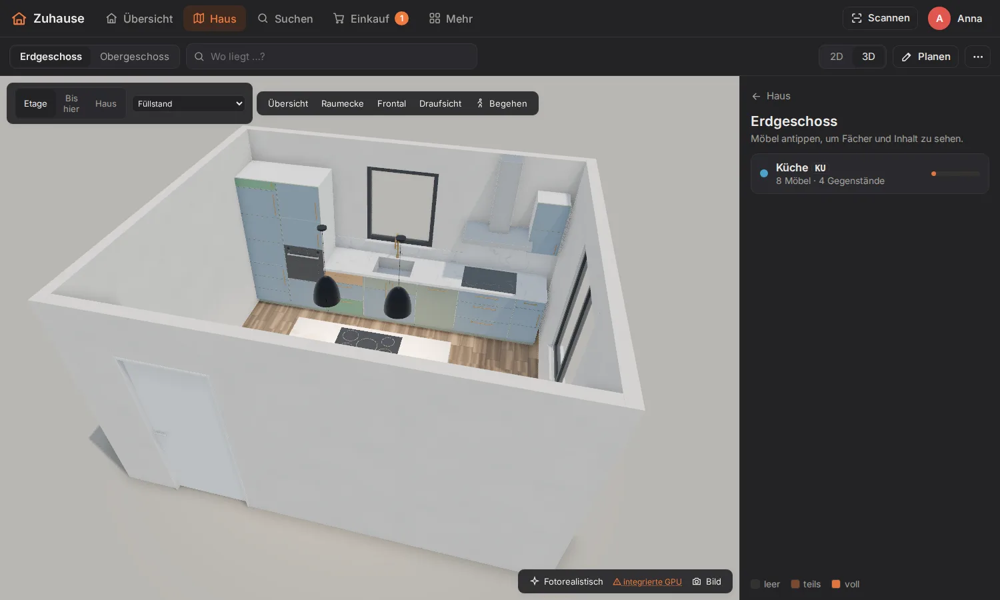

</div>

## What is it?

Where are the batteries? Is there any dish soap left? What expires this week? **homemgmt-ng** answers these questions
by modeling your house: you draw floors, walls and rooms, place furniture in them – and every compartment and every
drawer automatically becomes a **location** with its own code (`KU-C2` = kitchen, furniture C, compartment 2). You
check items in and take them out with a click, a QR scan, your voice or the AI assistant. The search "Where is …?"
lights up the matches in the house.

Everything runs on your own computer or server: **one** Node process, **one** SQLite file, no cloud.

The app is available in **German and English**. The language follows your browser and can be switched under *My account*.

## The AI assistant

Say, type or photograph what happened – the assistant books it into the right compartment.

- 📷 **Photograph a shelf = inventory done:** take a photo of the shelf or drawer, ideally with the compartment's QR
  label in the picture. The assistant recognizes **all items in the photo**, creates new ones, increases existing ones
  and checks everything into that compartment in one step – from four transactions on, only after you confirm. If you
  like, it stores the photo with the item.
- 🎤 **Just say it:** "3 cans of tomatoes into the pantry cabinet, best before 05/2027" – it understands compartments
  by name ("kitchen fridge top") and reads its answers aloud.
- 🔎 **Ask and find:** "Where is the cordless drill?", "What expires this week?" – with "Show in house".
- 🏷️ **QR labels in photos** are read by the app itself: "this goes here" is enough.
- 🛒 **Shopping and prices:** add to the list, tick off, "Where is butter cheapest right now?" (price research with
  retailer, store and source).
- 🖥️ **Talk to the wall terminal:** press "Speak", tap your tile, go – limited to search, transactions and shopping there.
- ↩️ **Safe:** every transaction can be undone, the assistant acts with the person's permissions; works with any
  OpenAI-compatible provider (OpenRouter, LiteLLM …), plus an MCP server for Claude & co. – details under
  [AI assistant and MCP server](#ai-assistant).

## Features

<table>
<tr>
<td width="50%">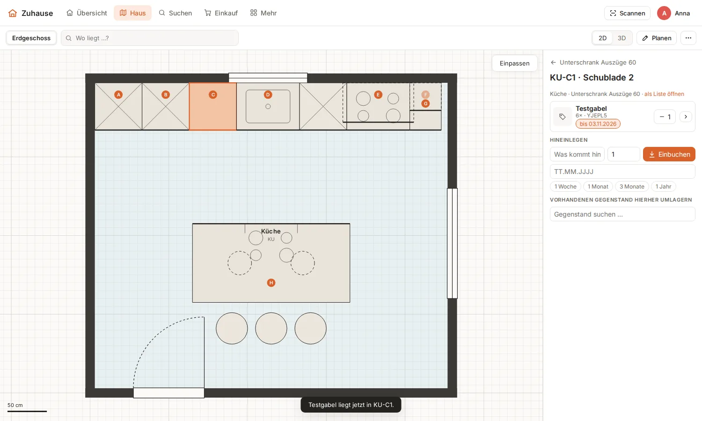</td>
<td width="50%">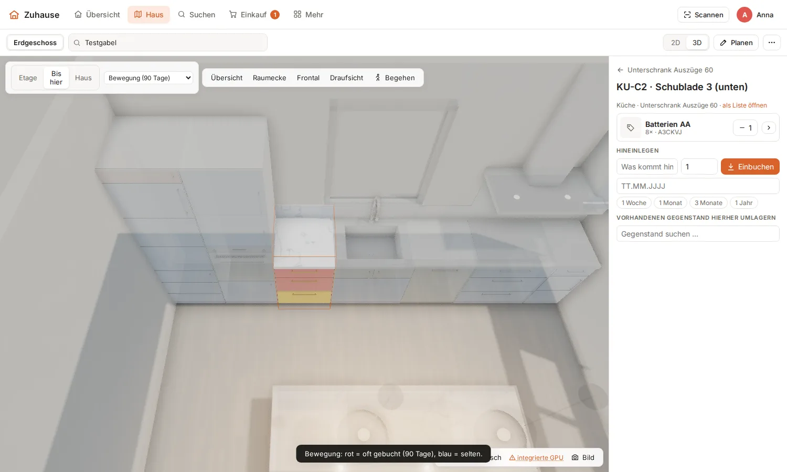</td>
</tr>
<tr>
<td><b>Inventory in the plan:</b> tap a piece of furniture to see its compartments, a compartment to see its contents – check in, take out, move.</td>
<td><b>Inventory in 3D:</b> compartments colored by fill level, expiry or activity (heatmap).</td>
</tr>
<tr>
<td>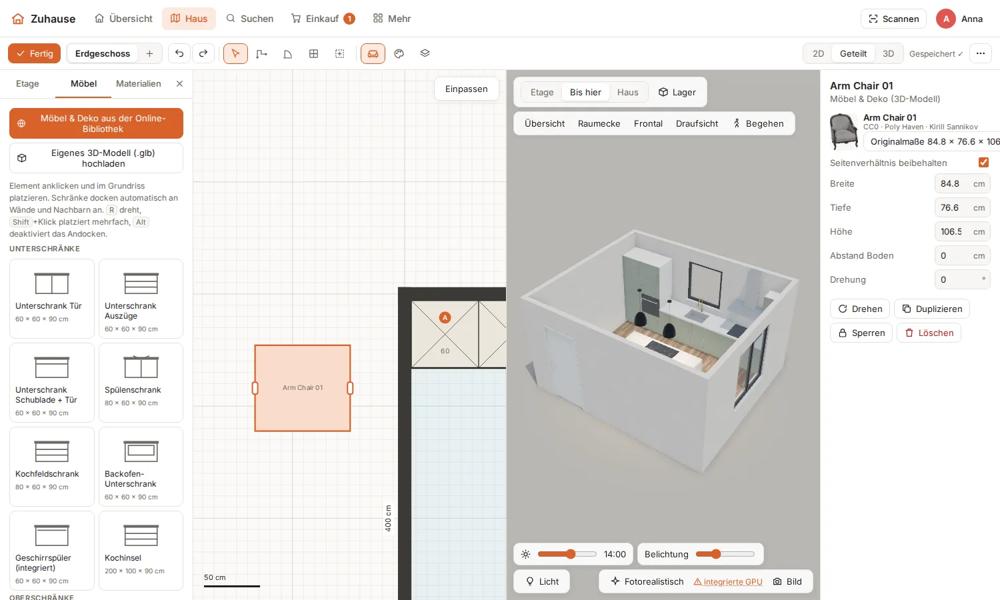</td>
<td>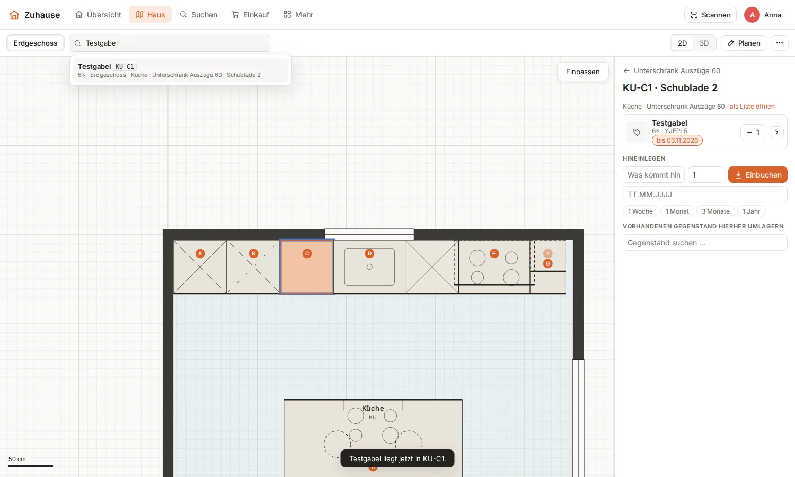</td>
</tr>
<tr>
<td><b>House planner:</b> draw walls or trace a floor plan, furniture catalog, 3D models from online libraries.</td>
<td><b>"Where is …?":</b> search across all storage areas, matches light up in the house.</td>
</tr>
</table>

### 🏗️ Plan your house

- **Floors** – ground floor, upper floor, basement, attic and outdoors, with the floor below as a drawing aid
- **Walls** with snapping and dimensions, doors, windows, stairs; upload a floor plan image and trace it
- **Rooms** with one click into an enclosed area – every room becomes a storage area with a code (kitchen → `KU`)
- **Furniture catalog**: kitchen cabinets, shelf units, heavy-duty shelving, pantry and wardrobe, sideboard, chest of
  drawers, workbench
- **Object library**: build your own furniture types in the editor (columns, drawers, doors with shelves, open
  compartments – or your own 3D model with compartments) and install them from the **community catalog**
  ([homemgmt-object-library](https://mupf-dev.github.io/homemgmt-object-library/)); every compartment becomes a location
- **3D models** from [Poly Haven](https://polyhaven.com) (CC0) and FurniMesh – search and place them, or upload your own `.glb`
- **3D view** with PBR materials, daylight by time of day, **photorealistic path tracing** and **walk-through** like
  in a game (including stairs between floors)
- **House location**: address or coordinates and north direction – the sun is where it is outside

### 📦 Inventory

- **Check in, take out, move, undo** with a complete history per item
- **QR scan** with the phone camera: compartment code + item = check in, the same item twice = take out
- **Labels & QR signs** to print – or as a 3D print model (STL/3MF, multicolor too)
- **Shopping list**: consumables land on it automatically when taken out, share via WhatsApp
- **Household tasks**: recurring, assigned to people, attached to compartments ("replace filter"), can be ticked off
  on the wall terminal too
- **Expiry** with warnings, **containers** (a box inside the toolbox), **photos** per item
- **Insights**, **export/import** as Excel, **automatic backups**
- **Offline-safe**: transactions made on poor Wi-Fi are queued and synced automatically

### 📱 On your phone

<table>
<tr>
<td align="center" width="50%">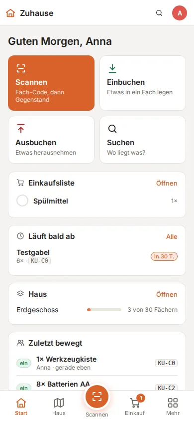</td>
<td align="center" width="50%">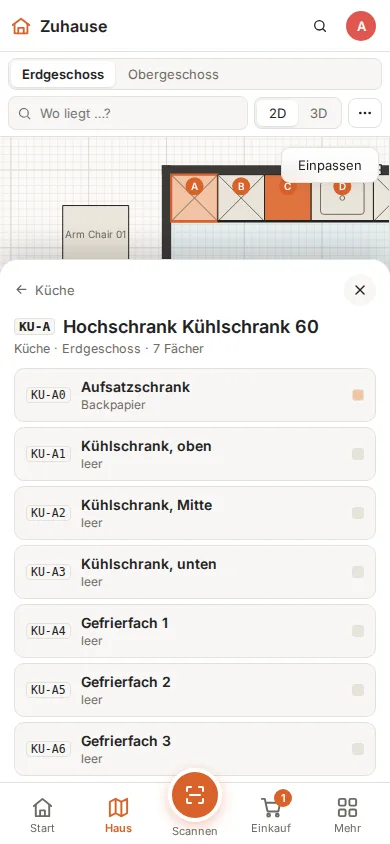</td>
</tr>
<tr>
<td align="center">Overview: quick actions, shopping, expiring items</td>
<td align="center">Compartment as a bottom sheet</td>
</tr>
</table>

- **Installable as an app** (PWA) with shortcuts; on the phone a bar at the bottom with **Scan** in the middle
- **Overview** as the home page: quick actions, shopping list to tick off, what expires soon, fill level per floor,
  recently moved
- **Poor Wi-Fi**: transactions are queued ("2 transactions waiting") and synced automatically – the server never books twice
- **Multiple people** signing in with a tile + PIN/password or email, "Plan house" permission per person
- **Settings per person**: home page, house in 2D or 3D first, light/dark, font size

<a id="wall-terminal"></a>

### 🖥️ Wall terminal

A tablet on the wall becomes the control center for everyone in the house – without personal sign-in.

<table>
<tr>
<td width="50%">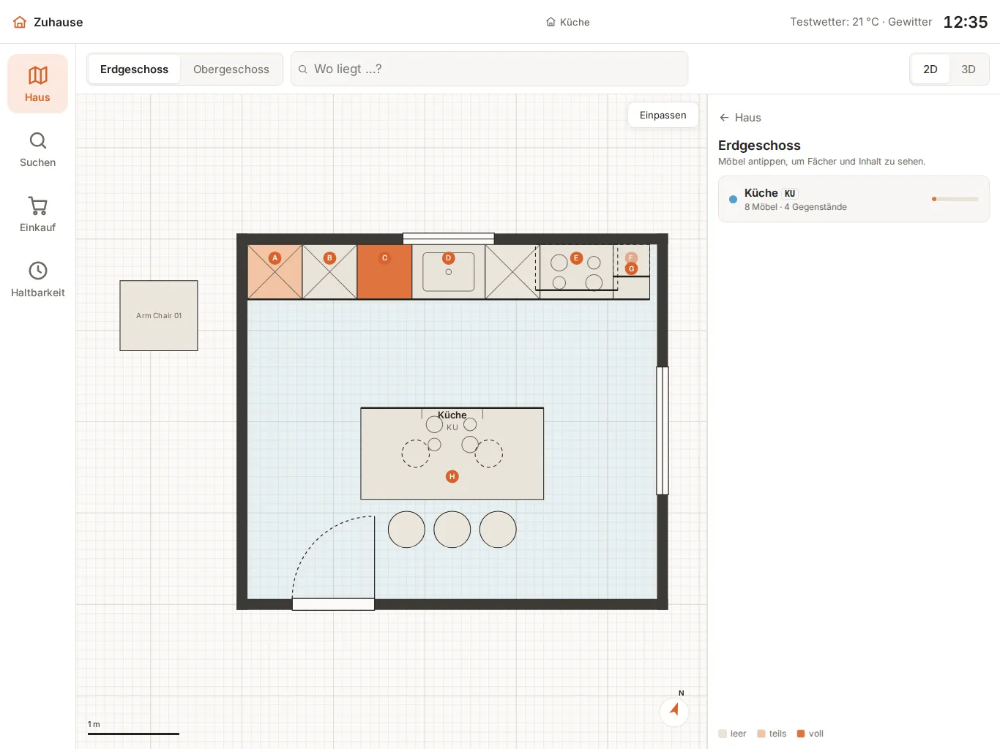</td>
<td width="25%">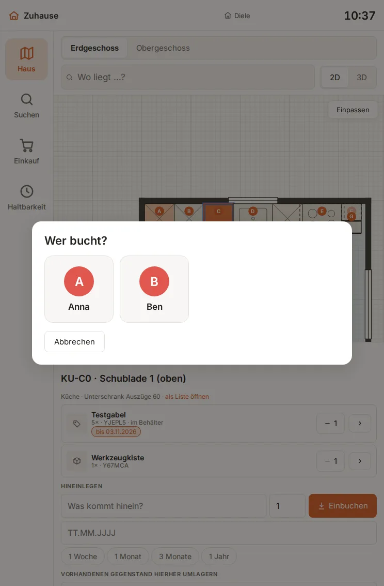</td>
<td width="25%">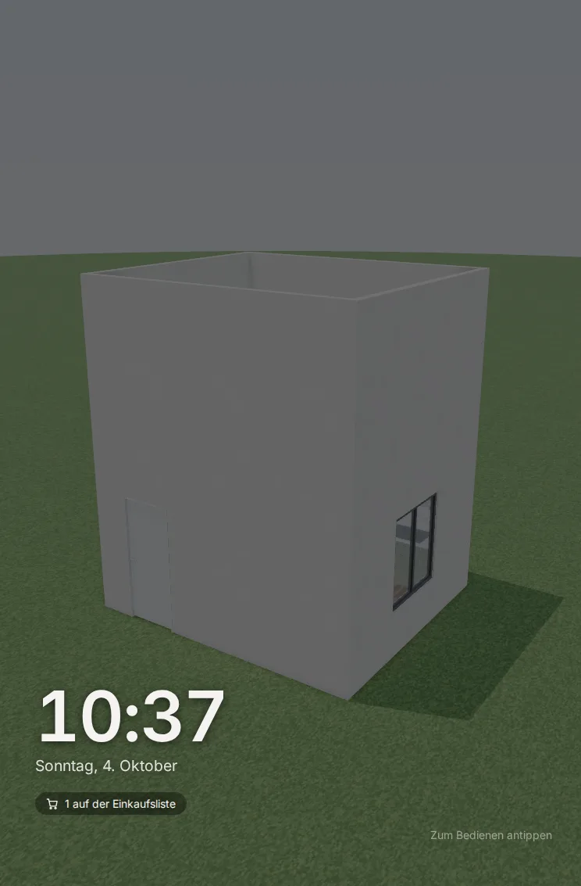</td>
</tr>
<tr>
<td>Landscape: navigation on the left edge, weather and clock at the top</td>
<td>"Who is booking?"</td>
<td>Idle mode</td>
</tr>
</table>

- **Setup:** *Administration → Wall terminals → Add wall terminal*, then open the **setup link** or its **QR code** on
  the tablet – no password on the device. Regenerate the link or remove the terminal at any time.
- **Configurable per device:** portrait or landscape, house as floor plan or 3D, light/dark, font size up to "very
  large", minutes until it returns to the house, idle mode on/off, level of detail (draft 15 s, normal 30 s, high 90 s),
  postal code for the weather.
- **Booking for everyone:** tap a compartment, check in or take out, then tap your own **"Who is booking?"** tile; the
  person is remembered for 90 seconds. Large touch targets; only house, search, shopping and expiry – planning is locked.
- **Idle mode:** the house dimmed and photorealistic with lawn, a large clock, date, weather, shopping list and
  expiring items. Economical: re-renders only when the sun or weather changes, pauses when the screen is hidden.

<a id="live-weather"></a>

### 🌦️ Live weather at the house

<table>
<tr>
<td width="20%">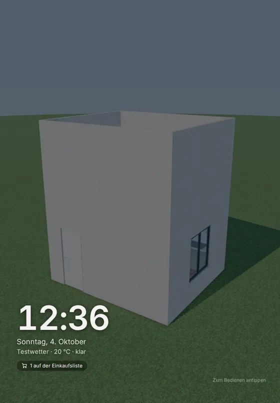</td>
<td width="20%">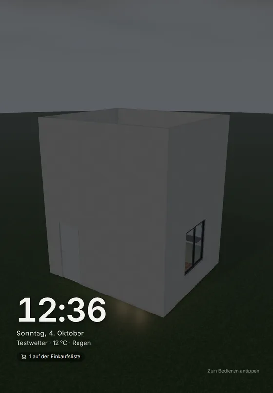</td>
<td width="20%">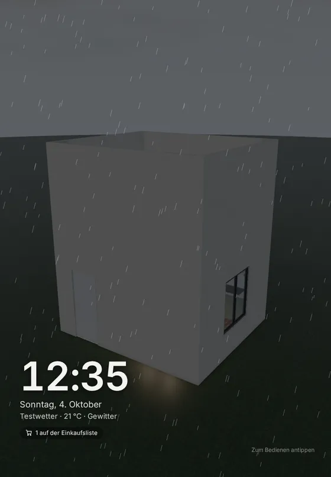</td>
<td width="20%">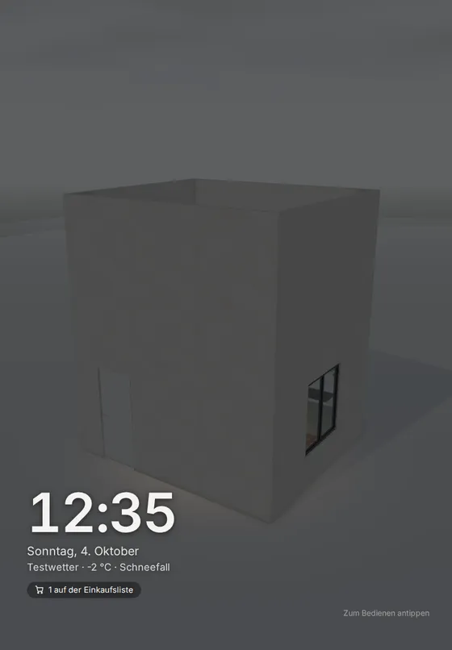</td>
<td width="20%">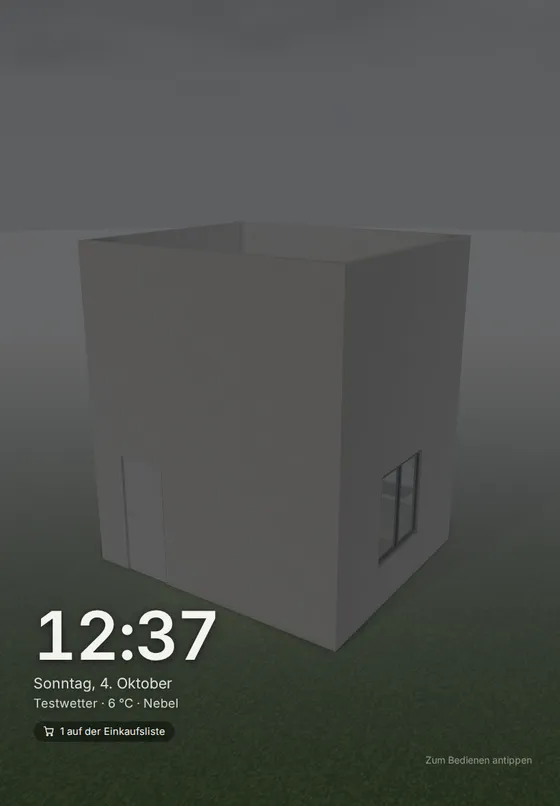</td>
</tr>
<tr>
<td align="center">Clear</td><td align="center">Rain</td><td align="center">Thunderstorm</td><td align="center">Snow</td><td align="center">Fog</td>
</tr>
</table>

With the **house location** (*Plan → ⋯*: address, postal code or coordinates, north direction via compass) the wall
terminal shows the house as it looks outside – no account and no API key needed:

- **Sun as outside:** sun position from location and time; sky and light follow every minute – day, dusk, night with
  lamps switched on and moonlight. The floor plan shows a north arrow.
- **Clouds** according to real cloud cover, colored by time of day, drifting with the wind – in the photorealistic image too.
- **Rain and drizzle** as a subtle animation based on the real rain rate (mm/h), the lawn gets wet; **fog and haze**
  based on visibility; temperature and precipitation in the header.
- **Snow** grows as a patch: first on and in front of the terrace, from ~10 cm the whole garden; the roof goes from
  dusted to white.
- **Thunderstorms in real time:** every lightning strike nearby arrives instantly ([Blitzortung.org](https://www.blitzortung.org),
  via server-sent events). Close strikes (≤ 30 km) make the screen flash, from 20 km the header shows a warning, and
  idle mode shows the last strike (distance, direction, age) and a **lightning map** (10/25/50 km).
- **Test weather** to try it out: open the terminal address with `?testwetter=schnee` (snow; also `schnee-hauch`
  light snow, `schneesturm` blizzard, `niesel` drizzle, `regen` rain, `wolkenbruch` downpour, `gewitter` thunderstorm,
  `nebel` fog, `wolkig` cloudy, `klar` clear) – that is how the images above were made.

Data: location via [OpenStreetMap](https://www.openstreetmap.org), weather via [Open-Meteo](https://open-meteo.com) (every 15 minutes).

<a id="ai-assistant"></a>

### 🤖 AI assistant and MCP server

- **Assistant in the app** by text, voice or photo: *"3 cans of tomatoes to basement B2, best before 05/2027"* –
  books by itself, every transaction with "undo". Works with any OpenAI-compatible API (e.g. OpenRouter).
- **MCP server** for AI assistants like Claude: search, check in/take out, move, shopping list – authenticated with an API key

## A real house

homemgmt-ng was built for a real single-family house – with basement, ground floor, upper floor, attic and outdoor
area. These images show the plan of that house (taken with an earlier version of the interface).

<table>
<tr>
<td width="50%">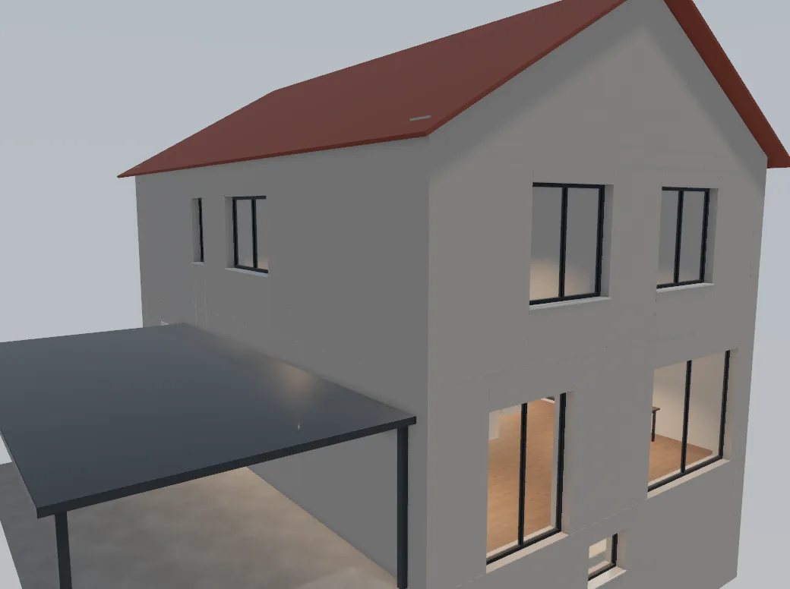</td>
<td width="50%">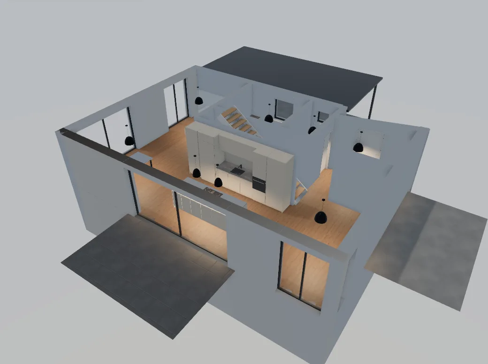</td>
</tr>
<tr>
<td><b>Outside:</b> gable roof, windows, carport and terrace – all floors stacked.</td>
<td><b>Ground floor:</b> kitchen run with tall cabinets, cooking island, stairs and living area.</td>
</tr>
<tr>
<td>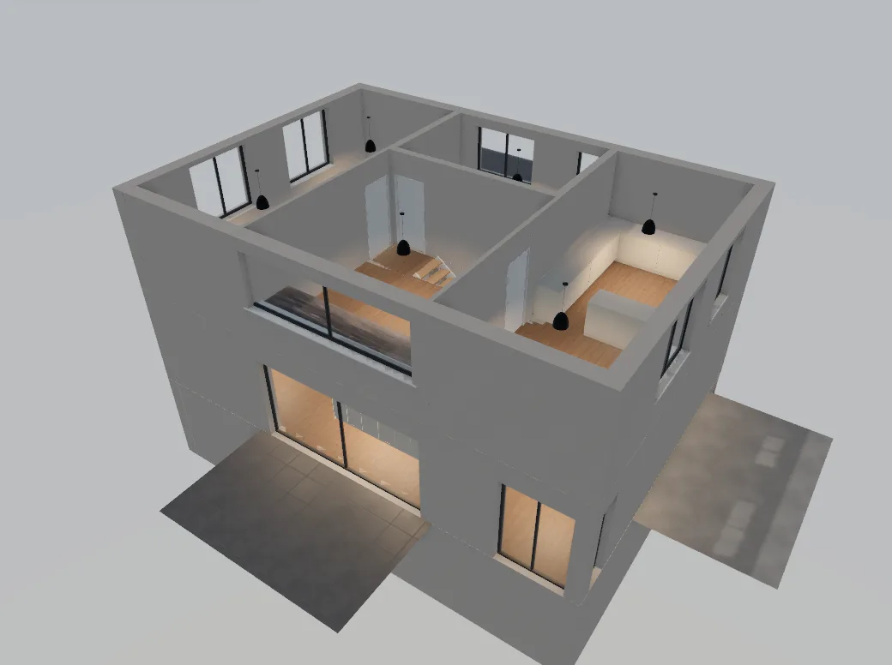</td>
<td></td>
</tr>
<tr>
<td><b>Upper floor:</b> "Up to here" shows the floor with everything below it.</td>
<td><b>Kitchen:</b> handleless fronts, a passage disguised as a cabinet, stone worktop.</td>
</tr>
<tr>
<td>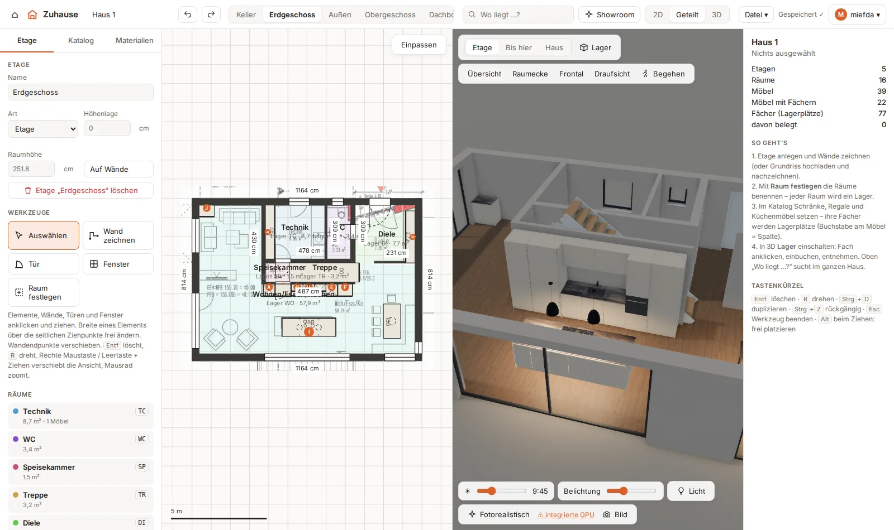</td>
<td>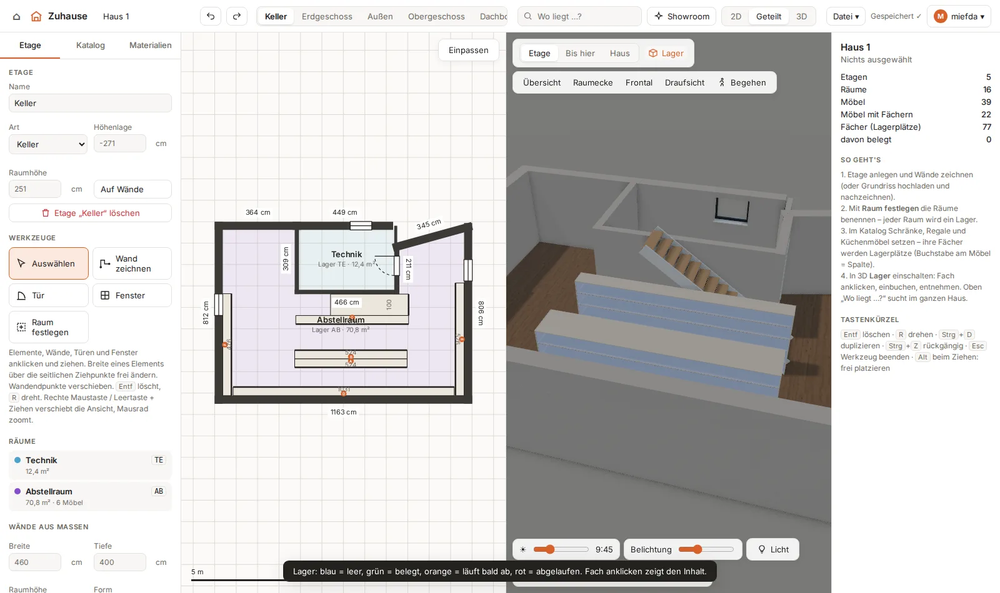</td>
</tr>
<tr>
<td><b>Floor plan:</b> traced over the scanned building plan, rooms as storage areas.</td>
<td><b>Basement:</b> shelf units in the storeroom as locations, colored by fill level.</td>
</tr>
</table>

## Installation

### With Docker (recommended)

```bash
git clone https://github.com/mupf-dev/Homemgmt.git
cd Homemgmt
docker compose up -d --build
```

The app then runs at **http://localhost:3000** (MCP server: port 3100). The data lives in the volume `zuhause-data`
(`/data` in the container: `zuhause.db`, `backups/`, `library/`). Settings go into
[`docker-compose.yml`](docker-compose.yml) – the most important ones are already there, commented out.

### Without Docker

Requires **Node.js ≥ 22.18** (built-in `node:sqlite`; TypeScript runs on the server without a build step).

```bash
git clone https://github.com/mupf-dev/Homemgmt.git
cd Homemgmt
npm install
npm run build && npm start     # → http://localhost:3000
```

### First start

With an empty database the app shows the **initial setup**: tap "New person", choose a name and password – this person
becomes **admin**. After that you sign in with a tile + password/PIN or with your email. Add more people under
*More → Administration → People*; self-registration is off by default.

> [!TIP]
> For the **camera scan** on the phone the browser needs HTTPS. On your home network `npm run cert` is enough
> (self-signed certificate, the app is then at `https://<computer>:3443`); for permanent use a
> [reverse proxy](#behind-a-reverse-proxy) is better.

## Guide

### 1. Set up your house

1. Open **House** → **Plan** (PC only). The floor tabs are at the top; **+** adds an upper floor, basement, attic or
   outdoor area.
2. Draw **walls** – or upload a scan/photo of the floor plan under *Floor → Floor plan template*, calibrate the scale
   and trace it. For simple rooms: *Walls from dimensions*.
3. Choose **Define room** and click into an enclosed area. Every room becomes a **storage area** with a code.
4. Place **furniture** from the catalog; cabinets snap to walls and neighbors (`R` rotates, `Alt` places freely).
   Every piece of furniture with compartments gets a **letter**, every compartment a **location**: `KU-B2`
   (kitchen, furniture B, compartment 2).
5. **Done** – the plan is saved automatically and shared with everyone.

### 2. Store and find things

- **View** is the normal mode: tap a piece of furniture → compartments, tap a compartment → contents, **Check in** or
  **− 1** to take one out.
- In 3D, **Inventory** colors compartments by fill level: blue empty, green occupied, orange expiring, red expired.
- **"Where is …?"** at the top searches all storage areas; matches light up in the floor plan and in 3D, floors with
  matches get a dot.
- On the phone: **Scan** in the middle of the bar. Scan the compartment code first, then the item = check in;
  the same item twice = take out. Unknown pre-printed labels create a new item.

### 3. Print labels

*More → Labels & QR signs*: labels for compartments, items or **blank labels** to stick on in advance (large
7 × 3.6 cm or small 5 × 2.5 cm). In the location and item views, **3D print** creates a QR sign as STL or multicolor
3MF – entirely in the browser.

### 4. Shopping list and expiry

Mark items as **consumables** – when taken out they land on the **shopping list**. Tick them off there – or mark them
as bought and check them straight back into their previous location. With a **best-before date** they show up in time
under *Expiring soon*.

### 5. Set up a wall terminal

*Administration → Wall terminals → Add wall terminal*: choose portrait or landscape, then open the **setup link** (or
its QR code) on the tablet. The terminal needs no personal sign-in; when booking it asks **"Who is booking?"**. When
not in use it switches to idle mode – with the **house location** (*Plan → ⋯*) including sun, sky and weather as
outside. If there is lightning nearby, the terminal shows a warning and a lightning map. To try it out: open the
address with `?testwetter=schnee` (or `regen`, `gewitter`, `nebel` …).

### 6. AI assistant and MCP server

**Assistant:** *Administration → Assistant* – enter the address of an OpenAI-compatible API (default
`https://openrouter.ai/api/v1`), a model (with tool calling; with image input for photos) and an API key, then
*Test connection*. The key stays on the server. Price research needs a web search: OpenRouter includes one; with a
gateway like LiteLLM, enter its search tool under "Search tool in gateway".

**MCP:** create a key under *Administration → API keys* ("Read and book" or "Read only"), then e.g. in Claude Code:

```bash
claude mcp add --transport http zuhause http://localhost:3100/mcp --header "Authorization: Bearer hlk_…"
```

The complete manual for all inventory features is in **[docs/INVENTORY.md](docs/INVENTORY.md)**, the planner in
[docs/KITCHEN.md](docs/KITCHEN.md), background in [ARCHITECTURE.md](ARCHITECTURE.md) and what's new in the
[CHANGELOG](CHANGELOG.md).

## Operation

### Environment variables

| Variable | Default | Meaning |
|----------|---------|---------|
| `PORT` | `3000` | HTTP port |
| `HTTPS_PORT` | `3443` | HTTPS (only with a certificate in `CERT_DIR`, `npm run cert`), `0` = off |
| `DB_PATH` | `data/zuhause.db` | Database; backups and textures are stored next to it |
| `MCP_PORT` / `MCP_HOST` / `MCP_PUBLIC_URL` | `3100` / `0.0.0.0` / – | MCP server (`MCP_PORT=0` = off) |
| `TRUST_PROXY` | – | `1` behind a reverse proxy (secure cookie, real client IP) |
| `BACKUP_INTERVAL_HOURS` / `BACKUP_KEEP` | `24` / `14` | automatic backups |
| `AI_API_KEY` / `AI_BASE_URL` / `AI_MODEL` | – | AI assistant (otherwise under *Administration → Assistant*) |
| `AI_SEARCH_TOOL` | – | Search tool of a gateway (e.g. LiteLLM) for price research without OpenRouter |
| `LIGHTNING` | – | `0` turns off live lightning (Blitzortung.org) for wall terminals |
| `OBJECT_CATALOG_URL` | `https://mupf-dev.github.io/homemgmt-object-library/` | Community catalog of the object library (your own fork or a local mirror) |

More variables (e.g. `MCP_ALLOWED_ORIGINS`, `PUBLIC_URL`) are listed in [docs/INVENTORY.md](docs/INVENTORY.md).

### Behind a reverse proxy

For permanent operation with HTTPS (Caddy, nginx, Traefik …) forward to the app on port 3000 and set `TRUST_PROXY=1`.
Only expose the MCP server if you need it, and turn off buffering there (Caddy `flush_interval -1`,
nginx `proxy_buffering off`). Details: [docs/INVENTORY.md](docs/INVENTORY.md#behind-a-reverse-proxy-recommended).

### Backups and forgotten passwords

Backups are created automatically (every 24 h by default, 14 are kept) and can be created, downloaded and restored
under *Administration → Backups*. To reset a password:

```bash
npm run reset-password -- anna                                             # without Docker
docker compose exec zuhause node scripts/reset-password.cjs anna           # with Docker
```

### Importing existing data

From the predecessor projects **Heimlager** and **Küchenplaner** (the sources are only read):

```bash
npm run migrate -- --lager ../inventory/data/lager.db --kueche ../küchenplaner/data/kuechenplaner.db
```

Accounts with the same email or the same name are merged into one person (otherwise `--map mail@example.de=Name`). In
the app, the account menu entry **"Import saved plans"** brings a kitchen plan into the house as a floor. For the
house floor plan of a running Heimlager instance there is `npm run import-prod` (see the header of
[`scripts/import-prod.ts`](scripts/import-prod.ts)).

Copy a migrated database into the Docker container:

```bash
docker compose create
docker compose cp ./data/zuhause.db zuhause:/data/zuhause.db
docker compose cp ./data/library zuhause:/data/library
docker compose run --rm -u root --entrypoint chown zuhause -R node:node /data
docker compose up -d
```

## Development

```bash
npm run dev          # one process, app with Vite HMR → http://localhost:3000
npm test             # API tests, each with its own server and a fresh database
npm run typecheck    # app and server
npm run test:e2e     # click-through test in the browser (once: npm install --no-save playwright-core)
```

### Structure

```
server/index.ts            Entry point: Express, modules, HTTPS, MCP
server/lager/              Inventory: account, storage areas, transactions, assistant, MCP, backups
server/haus/               House: saving the house plan, sync with the inventory
server/kueche/             Plans, user management, material library
web/app/src/model/         House model for app and server: types, catalog, geometry, rooms, compartments
web/app/src/               App: editor (plan2d), 3D (scene3d, models, materials), state, account
scripts/                   migrate, reset-password, make-cert, make-icons, import-prod
test/                      node:test, e2e/ click-through test in the browser
docs/                      Manuals and changelogs of the original projects
site/                      Project website (GitHub Pages) and screenshots
```

**Tech:** Express 5, built-in `node:sqlite`, TypeScript (server via type stripping without a build), Vite, three.js,
three-gpu-pathtracer.

### API (house)

| Method | Path | Purpose |
|--------|------|---------|
| GET | `/api/house` | House plan `{house, version, can_edit, reserved}` |
| PUT | `/api/house` | Save `{house, base_version}` → normalized plan, sync with the inventory; 409 if the version is outdated |
| GET | `/api/house/storage` | All plan locations with code and contents |
| GET | `/api/objects` | Object library: installed furniture types (`zuhause-objekt/1`) |
| PUT / PATCH / DELETE | `/api/objects/:id` | Save, hide/show or delete a furniture type ("Plan house" permission) |
| POST | `/api/objects/import` | Import a furniture type from a file (`{object, replace?}`) |
| GET / POST | `/api/objects/community`, `/api/objects/community/install` | Read the community catalog, install/update a furniture type |

The remaining endpoints (storage areas, transactions, account, assistant, backups) are documented in
[docs/INVENTORY.md](docs/INVENTORY.md#api-for-custom-extensions). API keys (`Authorization: Bearer hlk_…`) work for
the REST API as well.

## License

[GNU Affero General Public License v3.0](LICENSE). You may use, modify and share homemgmt-ng. Anyone who distributes a
modified version or offers it as an online service must publish the source code under the same license.

The house planner grew out of [Küchenplaner 3D](https://github.com/mupf-dev/kitchen-planner-3d) (kitchen planner,
[live demo](https://kuechenplaner.miefda.org/)).

## Acknowledgements

Floor textures and 3D models from [Poly Haven](https://polyhaven.com) (CC0) ·
[three.js](https://threejs.org) · [three-gpu-pathtracer](https://github.com/gkjohnson/three-gpu-pathtracer) ·
[qrcode-generator](https://github.com/kazuhikoarase/qrcode-generator) (MIT) · [jsQR](https://github.com/cozmo/jsQR) (Apache-2.0) ·
location and weather via [OpenStreetMap](https://www.openstreetmap.org) and [Open-Meteo](https://open-meteo.com)
